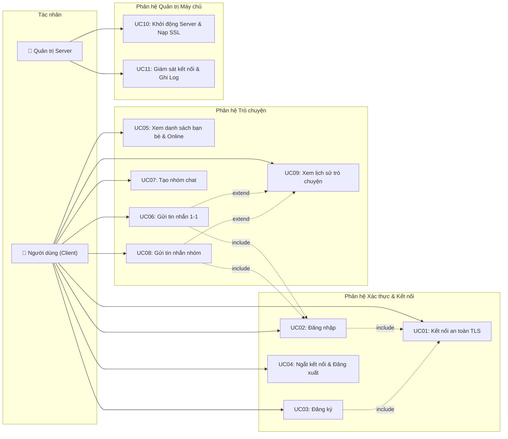
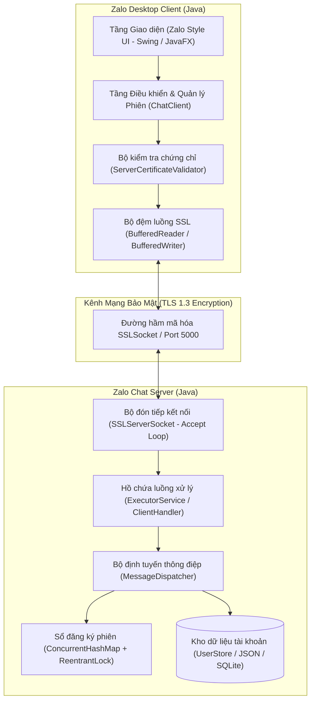
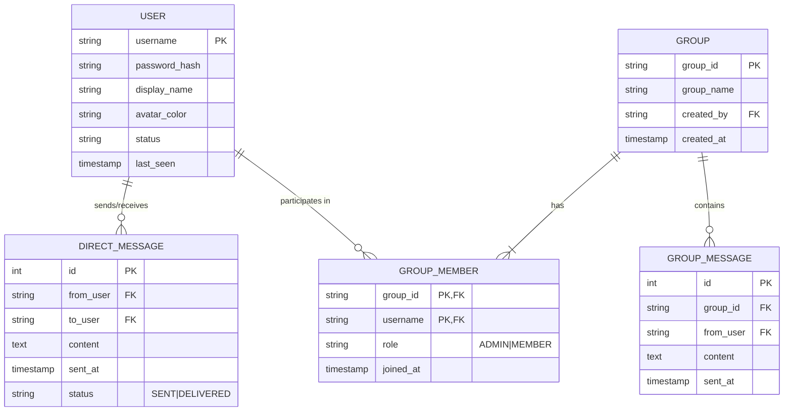

# Tài liệu Đặc tả Yêu cầu & Thiết kế Hệ thống (SRS & System Design)
## Đồ án: Xây dựng Ứng dụng Trò chuyện Trực tuyến Bảo mật Zalo Chat (Java Secure TCP Chat)

**Phiên bản**: 1.0  
**Ngày lập**: 07/11/2026  
**Kiến trúc tham chiếu**: Slide Chương 16.1 - Lập trình Mạng (Bảo mật mạng • Secure TCP Chat - ĐH Sài Gòn)  
**Tác giả**: Omni-IT Architect

---

## 1. Giới thiệu & Mục tiêu Dự án (Introduction & Vision)

### 1.1 Tầm nhìn (Vision)
Xây dựng một ứng dụng chat trên máy tính (Desktop Chat Application) mang trải nghiệm và giao diện lấy cảm hứng từ **Zalo**, được vận hành trên nền tảng kiến trúc mạng **Secure TCP Socket chuẩn hóa 100% theo bài giảng môn Lập trình mạng**. Ứng dụng đáp ứng các tiêu chuẩn bảo mật khắt khe: mã hóa toàn diện kênh truyền qua **TLS 1.3/SSLSocket**, cơ chế xác thực chứng chỉ số X.509, phân đoạn gói tin an toàn bằng **JSON Stream Frame**, khóa ghi độc quyền chống đan xen byte (`ReentrantLock sendLock`), và quản lý phiên đồng thời (`ConcurrentHashMap`).

### 1.2 Phạm vi nghiệp vụ (Scope)
- **Bao gồm (In-Scope)**:
  - Máy chủ Server TCP tập trung lắng nghe cổng bảo mật (TLS/SSL).
  - Quá trình bắt tay mật mã (TLS Handshake) sử dụng Java Keystore (`.p12`) và chứng chỉ số `server.crt`.
  - Xác thực người dùng bằng mật khẩu đã được băm an toàn (BCrypt).
  - Trò chuyện trực tiếp 1-1 (Direct Messaging) thời gian thực.
  - Trò chuyện theo nhóm (Group Chat Room) với cơ chế phân phối Broadcast an toàn luồng.
  - Quản lý danh bạ và trạng thái trực tuyến (Online/Offline Presence).
  - Lưu trữ lịch sử tin nhắn cục bộ (Local SQLite DB).
  - Giao diện người dùng Desktop hiện đại theo ngôn ngữ thiết kế của Zalo (Zalo Blue `#0068FF`, bố cục 3 cột: Sidebar icon - Danh sách hội thoại - Khung chat).
- **Không bao gồm (Out-of-Scope cho đồ án này)**:
  - Cuộc gọi thoại/video độ trễ thấp (WebRTC/UDP).
  - Lưu trữ đám mây phân tán hàng triệu người dùng (Microservices/Kafka/Cassandra).
  - Mã hóa đầu cuối (E2EE Signal Protocol) - trong đồ án này áp dụng mô hình bảo vệ mạng Client-Server TLS như slide giáo trình.

---

## 2. Bảng phân rã chức năng nguyên tử (Functional Decomposition)

Hệ thống được bóc tách thành **7 phân hệ** và **33 chức năng nguyên tử (Atomic Functions)**. Mọi chức năng ở tầng lá đều tuân thủ nguyên tắc: **1 động từ + 1 đối tượng duy nhất**, độc lập kiểm thử và trực tiếp ánh xạ vào code.

```text
Hệ thống Zalo Secure TCP Chat (Tổng cộng: 33 chức năng nguyên tử)
├── Phân hệ 1: Xác thực & Quản lý Tài khoản (Auth & Identity) — 7 chức năng
│   ├── 1.1 Đăng ký tài khoản
│   │   ├── 1.1.1 Nhập thông tin đăng ký (Username, DisplayName, Password)
│   │   ├── 1.1.2 Băm mật khẩu bằng thuật toán an toàn (BCrypt)
│   │   └── 1.1.3 Lưu bản ghi tài khoản vào kho dữ liệu UserStore
│   ├── 1.2 Đăng nhập hệ thống
│   │   ├── 1.2.1 Gửi thông điệp Login JSON qua kênh TLS
│   │   ├── 1.2.2 So khớp mật khẩu đã băm trên Server
│   │   ├── 1.2.3 Cấp phát định danh ClientId và phiên ClientSession
│   │   └── 1.2.4 Trả thông điệp phản hồi kết quả đăng nhập (LOGIN_OK/FAIL)
├── Phân hệ 2: Tầng Mạng Bảo mật & Quản lý Kết nối (Secure Network Transport) — 6 chức năng
│   ├── 2.1 Quản trị chứng chỉ số & Keystore
│   │   ├── 2.1.1 Tạo kho khóa PKCS12 (server.p12) và Private Key RSA 2048
│   │   ├── 2.1.2 Xuất chứng chỉ công khai X.509 (server.crt) cho Client
│   │   └── 2.1.3 Nạp SSLContext từ Keystore phía Server
│   ├── 2.2 Quản lý kênh truyền an toàn
│   │   ├── 2.2.1 Mở cổng SSLServerSocket lắng nghe kết nối
│   │   ├── 2.2.2 Thực hiện TLS 1.3 Handshake và thiết lập Session Key
│   │   └── 2.2.3 Xác thực tên miền chứng chỉ Server phía Client (SAN Matching)
├── Phân hệ 3: Quản lý Trạng thái & Danh bạ (Presence & Contacts) — 4 chức năng
│   ├── 3.1 Quản lý trạng thái kết nối
│   │   ├── 3.1.1 Đăng ký ClientSession vào ConcurrentHashMap trên Server
│   │   ├── 3.1.2 Gỡ bỏ ClientSession khỏi ConcurrentHashMap khi ngắt kết nối
│   │   ├── 3.1.3 Phát thông báo thay đổi trạng thái trực tuyến tới danh bạ
│   │   └── 3.1.4 Lấy danh sách toàn bộ người dùng đang online/offline
├── Phân hệ 4: Trò chuyện Trực tiếp 1-1 (Direct Messaging) — 4 chức năng
│   ├── 4.1 Gửi & Nhận tin nhắn cá nhân
│   │   ├── 4.1.1 Soạn và đóng gói thông điệp DirectMessage JSON
│   │   ├── 4.1.2 Ghi dữ liệu an toàn ra SSLSocket bằng SendLock (ReentrantLock)
│   │   ├── 4.1.3 Định tuyến và chuyển tiếp tin nhắn tới đúng Client đích
│   │   └── 4.1.4 Lưu vết tin nhắn vào cơ sở dữ liệu lịch sử cục bộ
├── Phân hệ 5: Trò chuyện Nhóm (Group Chat Room) — 4 chức năng
│   ├── 5.1 Quản trị nhóm chat
│   │   ├── 5.1.1 Tạo nhóm trò chuyện mới với danh sách thành viên ban đầu
│   │   ├── 5.1.2 Thêm thành viên mới vào nhóm chat hiện hữu
│   │   ├── 5.1.3 Thực hiện Broadcast tin nhắn nhóm tới các thành viên online
│   │   └── 5.1.4 Phát thông điệp hệ thống khi thành viên tham gia hoặc rời nhóm
├── Phân hệ 6: Đóng gói & Phân giải Giao thức (Protocol & Framing Engine) — 4 chức năng
│   ├── 6.1 Xử lý khung dữ liệu Stream
│   │   ├── 6.1.1 Tuần tự hóa đối tượng thông điệp thành chuỗi JSON UTF-8
│   │   ├── 6.1.2 Đính kèm ký tự phân cách ranh giới dòng (\n)
│   │   ├── 6.1.3 Phân tách và ghép các dòng dữ liệu hoàn chỉnh từ luồng byte
│   │   └── 6.1.4 Kiểm tra tính toàn vẹn và độ dài an toàn của gói JSON (max 16KB)
└── Phân hệ 7: Giao diện Người dùng Zalo Desktop (Zalo UI Client) — 4 chức năng
    ├── 7.1 Giao diện tương tác
    │   ├── 7.1.1 Hiển thị màn hình đăng nhập / cấu hình kết nối chuẩn Zalo
    │   ├── 7.1.2 Hiển thị bố cục chính 3 cột (Sidebar, Conversation List, Chat Area)
    │   ├── 7.1.3 Hiển thị bong bóng tin nhắn phân biệt người gửi / người nhận
    │   └── 7.1.4 Cập nhật giao diện bất đồng bộ không gây nghẽn UI Thread
```

**Tổng kết**: Đúng 33 chức năng nguyên tử, không có chức năng nào gom gộp hoặc chứa nhiều hành động.

---

## 3. Biểu đồ Use Case (Use Case Diagram & Relations)



### Đặc tả chi tiết Use Case trọng yếu: UC06 - Gửi tin nhắn cá nhân 1-1
- **Actor chính**: Người dùng đã đăng nhập (AUTHENTICATED).
- **Tiền điều kiện**: Kênh kết nối TLS đã bật, đăng nhập thành công, danh bạ đã tải.
- **Hậu điều kiện**: Tin nhắn được chuyển tiếp đến người nhận ngay tức thì nếu online, lưu vào CSDL cục bộ của cả 2 phía.
- **Luồng sự kiện chính**:
  1. Người dùng chọn một người bạn từ danh bạ bên trái.
  2. Hệ thống tải lịch sử chat cũ hiển thị lên màn hình.
  3. Người dùng nhập tin nhắn vào khung input và bấm "Gửi" (hoặc nhấn Enter).
  4. Client đóng gói message dạng JSON `{"type":"direct_message", "toUser":"binh", "content":"Chào bạn"}` và gửi qua SSLSocket bằng `sendLock`.
  5. Server nhận message, tra cứu `ConcurrentHashMap` tìm kiếm `ClientSession` của "binh".
  6. Server ghi message tới `SSLSocket` của "binh" bằng khóa ghi của "binh".
  7. Client của "binh" nhận thông điệp, bóc tách JSON và cập nhật lên UI Thread (`Platform.runLater`).

---

## 4. Kiến trúc Hệ thống & Sơ đồ Luồng dữ liệu (System Architecture)

### 4.1 Kiến trúc tổng thể 4 tầng (Layered Architecture)



### 4.2 Thiết kế Khóa ghi đồng thời (Concurrency & Thread-Safety Pattern)
Tuân thủ nghiêm ngặt **Slide 20 & Slide 26**:
- Mỗi kết nối Client được đại diện bởi một `ClientSession`.
- Trong `ClientSession` tích hợp một khóa độc quyền `private final ReentrantLock sendLock = new ReentrantLock();`.
- Khi Server thực hiện Broadcast tin nhắn nhóm tới 10 Client cùng lúc từ nhiều luồng khác nhau, thao tác ghi vào `OutputStream` của mỗi client luôn được bảo vệ trong khối:
  ```java
  clientSession.getSendLock().lock();
  try {
      writer.println(jsonMessage);
      writer.flush();
  } finally {
      clientSession.getSendLock().unlock();
  }
  ```
- **Ngăn chặn triệt để**: lỗi đan xen byte (`Byte Interleaving`), vỡ khung JSON khi nhiều người cùng chat một lúc.

---

## 5. Hợp đồng Giao thức Thông điệp (Message Protocol Contract)

Mọi thông điệp trao đổi qua đường truyền đều là một chuỗi **JSON duy nhất trên một dòng**, kết thúc bằng ký tự `\n` (UTF-8 Encoded). Kích thước tối đa cho phép là **16 KB**.

### 5.1 Các loại thông điệp (Message Types)

| Loại (Type) | Chiều truyền | Thuộc tính chính | Mục đích nghiệp vụ |
|:---|:---|:---|:---|
| `login` | Client ➔ Server | `username`, `password` | Yêu cầu đăng nhập |
| `login_result` | Server ➔ Client | `success` (bool), `clientId` (int), `message` (str) | Thông báo kết quả đăng nhập |
| `register` | Client ➔ Server | `username`, `password`, `displayName` | Đăng ký tài khoản mới |
| `register_result`| Server ➔ Client | `success` (bool), `message` (str) | Kết quả đăng ký |
| `direct_message` | 2 chiều | `from`, `to`, `content`, `timestamp` | Nhắn tin riêng 1-1 |
| `group_message` | 2 chiều | `groupId`, `from`, `content`, `timestamp` | Nhắn tin nhóm phòng chat |
| `group_create` | Client ➔ Server | `groupName`, `members` (list) | Tạo nhóm mới |
| `user_list` | Server ➔ Client | `users` (list danh sách kèm status Online/Offline) | Cập nhật danh bạ |
| `status_update` | Server ➔ Client | `username`, `status` ("ONLINE"/"OFFLINE") | Cập nhật trạng thái bạn bè |
| `disconnect` | Client ➔ Server | `username`, `reason` | Báo ngắt kết nối chủ động |
| `ping` / `pong` | 2 chiều | `timestamp` | Kiểm tra độ sống kết nối |

---

## 6. Mô hình Dữ liệu (Data Model)



---

## 7. Đề xuất Lựa chọn Công nghệ (Tech Stack Options)

Để hoàn thiện đồ án này, xin đề xuất **3 phương án triển khai** để bạn lựa chọn:

### 🌟 Lựa chọn A (Khuyến nghị cao nhất): Java 17+ & Swing FlatLaf (Zalo Desktop Look & Feel)
- **Tầng Mạng**: Java Core Socket, `javax.net.ssl.SSLSocket`, `SSLServerSocket`, TLS 1.3, Java Keystore PKCS12.
- **Tầng Phân giải JSON**: `com.google.code.gson` hoặc `Jackson Databind` (thư viện nhẹ, 1 file jar).
- **Tầng Giao diện (UI)**: **Java Swing kết hợp FlatLaf Dark/Light Theme**. 
  - *Lý do*: FlatLaf mang lại giao diện bo tròn phẳng lì hiện đại chuẩn Zalo Desktop (avatar tròn, thanh sidebar xanh `#0068FF`, search bar mờ, bóng chat hiện đại), nhưng **chạy ngay lập tức trên mọi máy tính chỉ cần cài JDK tiêu chuẩn**, không gặp các lỗi cấu hình phức tạp về module JavaFX (`--module-path`).
- **Lưu trữ**: SQLite JDBC hoặc JSON Flat-file Database.
- **Đánh giá**: Dễ nộp đồ án, thầy cô chấm bài mở lên chạy ngay bằng 1 lệnh `javac`/`java` hoặc mở trong Eclipse/IntelliJ không lo lỗi thư viện đồ họa.

### Lựa chọn B: Java 17+ & JavaFX (Zalo Modern Desktop)
- **Tầng Mạng**: Chuẩn Socket/SSLSocket giống hệt Option A.
- **Tầng Giao diện**: JavaFX với FXML và CSS styling.
- **Ưu điểm**: Hoạt ảnh (animation), hiệu ứng chuyển cảnh mượt mà, CSS linh hoạt.
- **Nhược điểm**: JDK từ bản 11 trở lên không tích hợp sẵn JavaFX; cần cấu hình Maven/Gradle hoặc gắn thêm SDK JavaFX khi mang máy sang trường chấm thi.

### Lựa chọn C: C# .NET 8 WPF / WinForms (Theo nhánh Slide C# song song)
- **Tầng Mạng**: `TcpListener`, `TcpClient`, `SslStream`, `System.Text.Json`.
- **Giao diện**: WPF XAML Zalo UI.
- **Ưu điểm**: Slide có song song cả code C#, giao diện Windows tự nhiên.
- **Nhược điểm**: Chỉ chạy tối ưu trên Windows, không nộp được nếu môn học bắt buộc ngôn ngữ Java.

