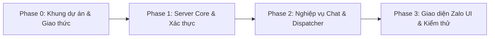

# Kế hoạch Triển khai Chi tiết (Implementation Plan)
## Đồ án: Zalo Secure TCP Chat (Java Desktop Application)

**Phiên bản**: 1.0  
**Ngày lập**: 07/11/2026  
**Trạng thái**: DRAFT — Đang chờ phê duyệt  
**Tài liệu liên quan**: [01-analysis-spec.md](./01-analysis-spec.md)

---

## 0. Tổng quan Dự án (Executive Summary)

| Thông tin | Giá trị quy định |
|:---|:---|
| **Mô hình kiến trúc** | Client-Server qua TCP/TLS 1.3, Đa luồng (Multi-threading), Khóa ghi SendLock |
| **Công nghệ lựa chọn** | Java 17+, SSLSocket, FlatLaf Swing (Giao diện Zalo Desktop), Gson/Jackson, SQLite |
| **Tổng số chức năng nguyên tử** | **33 chức năng** (100% bóc tách từ `01-analysis-spec.md`) |
| **Số giai đoạn (Phases)** | 4 giai đoạn (Phase 0 ➔ Phase 3) |
| **Tổng thời lượng ước tính** | 48 giờ làm việc |

---

## 1. Lộ trình Triển khai Tổng quan (Milestone Overview)

| Giai đoạn | Tên Giai đoạn | Thời lượng | Mục tiêu cốt lõi | Sản phẩm bàn giao chính |
|:---|:---|:---|:---|:---|
| **Phase 0** | Khởi tạo Khung dự án & Giao thức | 10h | Script tạo Keystore TLS, Model thông điệp, Frame Stream | Thư mục source, `server.p12`, `server.crt`, `MessageProtocol` |
| **Phase 1** | Xây dựng Server Core & Xác thực | 12h | SSLServerSocket, Accept Loop, BCrypt UserStore, ThreadPool | Server lắng nghe cổng 5000, bắt tay TLS và đăng nhập thành công |
| **Phase 2** | Nghiệp vụ Chat 1-1, Nhóm & Danh bạ | 14h | Định tuyến 1-1, Broadcast phòng nhóm, Quản lý Online list | Bộ xử lý MessageDispatcher hoàn chỉnh, không đan xen byte |
| **Phase 3** | Giao diện Zalo Desktop & Kiểm thử | 12h | UI Zalo 3 cột (FlatLaf), bong bóng chat, bộ test kịch bản TC01-06 | File chạy hoàn chỉnh 2 cửa sổ chat qua lại, tài liệu hướng dẫn |

---

## 2. Kế hoạch Chi tiết từng Giai đoạn (Detailed Tasks Breakdown)

### 🚀 Giai đoạn Phase 0: Khởi tạo Khung dự án, Chứng chỉ TLS & Giao thức (10h)
> **Mục tiêu**: Chuẩn bị đầy đủ nền tảng mật mã, cấu trúc thư mục phân tách độc lập (Server - Client - Shared Model) và bộ động cơ đóng gói gói tin JSON theo đúng Slide 6 & 8.  
> **Phạm vi chức năng nguyên tử**: [2.1.1, 2.1.2, 6.1.1, 6.1.2, 6.1.3, 6.1.4]

#### 📋 Danh sách công việc chi tiết:

- [ ] **[P0-01] Thiết lập cấu trúc thư mục dự án và kịch bản Build** `(2h)`
  - **Module / File**: `build.bat`, `run_server.bat`, `run_client.bat`, `.gitignore`, `README.md`
  - **Phụ thuộc**: Không
  - **Chi tiết**: Phân tách rõ ràng 3 package: `com.zalo.server`, `com.zalo.client`, `com.zalo.model`. Cấu hình script biên dịch javac với encoding UTF-8 và nạp thư viện JSON.
  - **Tiêu chuẩn nghiệm thu (DoD)**: Chạy `build.bat` biên dịch thành công mà không có lỗi cấu trúc package.

- [ ] **[P0-02] Tự động hóa sinh Chứng chỉ số Server (PKCS12 Keystore & X.509)** `(2h)`
  - **Module / File**: `scripts/generate_certs.bat`, `certificates/server.p12`, `certificates/server.crt`
  - **Phụ thuộc**: P0-01
  - **Chi tiết**: Viết script gọi Java `keytool` tạo kho khóa `server.p12` (mật khẩu an toàn) và xuất chứng chỉ công khai `server.crt` với SubjectAltName `localhost` & `127.0.0.1` đúng theo Slide 8.
  - **Tiêu chuẩn nghiệm thu (DoD)**: File `server.p12` và `server.crt` được sinh ra, kiểm tra bằng `keytool -list` hiển thị đúng thông tin hợp lệ.

- [ ] **[P0-03] Xây dựng Lớp đối tượng Thông điệp & Bộ phân loại MessageType** `(3h)`
  - **Module / File**: `src/com/zalo/model/ChatMessage.java`, `src/com/zalo/model/MessageType.java`
  - **Phụ thuộc**: P0-01
  - **Chi tiết**: Hiện thực đầy đủ các trường: `type`, `username`, `password`, `displayName`, `toUser`, `groupId`, `content`, `timestamp`, `success`, `clientId`. Định nghĩa enum `MessageType` (`LOGIN`, `LOGIN_RESULT`, `DIRECT_MESSAGE`, `GROUP_MESSAGE`, `USER_LIST`, `DISCONNECT`, `PING`...).
  - **Tiêu chuẩn nghiệm thu (DoD)**: Unit test tuần tự hóa (serialize) và giải tuần tự hóa (deserialize) 100% khớp dữ liệu, không bị mất trường.

- [ ] **[P0-04] Xây dựng Động cơ Phân khung dòng byte (Packet Framing Engine)** `(3h)`
  - **Module / File**: `src/com/zalo/model/ProtocolFramer.java`
  - **Phụ thuộc**: P0-03
  - **Chi tiết**: Xử lý đọc luồng stream an toàn từ `BufferedReader`/`InputStream`, ghép mảnh dữ liệu, chặn tấn công tràn bộ nhớ (kiểm tra giới hạn max 16KB/thông điệp), bảo đảm mỗi thông điệp là 1 JSON hợp lệ kết thúc bằng `\n`.
  - **Tiêu chuẩn nghiệm thu (DoD)**: Test gửi 2 tin nhắn liên tiếp trên cùng một chuỗi byte (TCP stream coalescing) vẫn bóc tách chính xác 2 gói tin riêng biệt.

---

### ⚙️ Giai đoạn Phase 1: Xây dựng Server Core, Bắt tay TLS & Quản lý Xác thực (12h)
> **Mục tiêu**: Xây dựng máy chủ TCP bảo mật hoàn chỉnh, lắng nghe cổng 5000, thực hiện TLS Handshake tự động, xác thực tài khoản người dùng bằng BCrypt hash và quản lý phiên trong bộ nhớ.  
> **Phạm vi chức năng nguyên tử**: [1.1.1, 1.1.2, 1.1.3, 1.2.1, 1.2.2, 1.2.3, 1.2.4, 2.1.3, 2.2.1, 2.2.2, 2.2.3]

#### 📋 Danh sách công việc chi tiết:

- [ ] **[P1-01] Xây dựng Module Nạp Chứng chỉ & Khởi tạo SSLServerSocket** `(3h)`
  - **Module / File**: `src/com/zalo/server/SSLContextFactory.java`, `src/com/zalo/server/ZaloChatServer.java`
  - **Phụ thuộc**: P0-02
  - **Chi tiết**: Khởi tạo `SSLContext` từ file `server.p12`, tạo `SSLServerSocketFactory`, mở cổng lắng nghe `PORT = 5000`, thiết lập chỉ hỗ trợ TLSv1.2 và TLSv1.3 theo đúng Slide 12 & Slide 18.
  - **Tiêu chuẩn nghiệm thu (DoD)**: Server khởi động in log sẵn sàng trên cổng 5000, từ chối các kết nối sử dụng giao thức không an toàn (SSLv3/TLS 1.0).

- [ ] **[P1-02] Xây dựng Kho dữ liệu Người dùng & Băm Mật khẩu (UserStore)** `(3h)`
  - **Module / File**: `src/com/zalo/server/UserStore.java`, `src/com/zalo/server/SecurityHelper.java`
  - **Phụ thuộc**: P0-01
  - **Chi tiết**: Quản lý tài khoản người dùng (lưu trữ file `data/users.json` hoặc SQLite). Băm mật khẩu bằng BCrypt hoặc SHA-256 + Salt ngẫu nhiên. Cung cấp API kiểm tra đăng nhập và đăng ký tài khoản mới.
  - **Tiêu chuẩn nghiệm thu (DoD)**: Mật khẩu lưu trữ ở dạng hash, không bao giờ ghi password dạng rõ ra file hay log màn hình.

- [ ] **[P1-03] Xây dựng Luồng tiếp nhận Client và Quản lý Phiên (ClientSession & ClientHandler)** `(3h)`
  - **Module / File**: `src/com/zalo/server/ClientSession.java`, `src/com/zalo/server/ClientHandler.java`
  - **Phụ thuộc**: P1-01, P0-04
  - **Chi tiết**: Khi có socket mới kết nối, nạp vào `ClientHandler` chạy trong `ExecutorService`. Tạo đối tượng `ClientSession` chứa `clientId`, `username`, `SSLSocket`, và đặc biệt là `private final ReentrantLock sendLock = new ReentrantLock()`.
  - **Tiêu chuẩn nghiệm thu (DoD)**: Chấp nhận đồng thời nhiều client kết nối mà không làm treo vòng lặp Accept.

- [ ] **[P1-04] Xử lý Luồng Đăng nhập & Đăng ký an toàn qua TLS** `(3h)`
  - **Module / File**: `src/com/zalo/server/AuthHandler.java`
  - **Phụ thuộc**: P1-02, P1-03
  - **Chi tiết**: Tiếp nhận gói tin `login` hoặc `register`. Nếu hợp lệ, chuyển trạng thái `ClientSession` sang `AUTHENTICATED`, đăng ký vào bảng `ConcurrentHashMap` của Server và trả thông điệp `login_result` thành công. Nếu sai, trả thông báo lỗi và ngắt kết nối.
  - **Tiêu chuẩn nghiệm thu (DoD)**: Kiểm thử kịch bản đăng nhập sai pass bị từ chối; chỉ client có `AUTHENTICATED == true` mới được gửi tin nhắn.

---

### 💬 Giai đoạn Phase 2: Nghiệp vụ Chat 1-1, Nhóm & Đồng bộ Danh bạ (14h)
> **Mục tiêu**: Hiện thực hóa trải nghiệm nhắn tin giống Zalo: chat trực tiếp 1-1, tạo nhóm chat, gửi tin nhắn nhóm, cập nhật trạng thái online thời gian thực và dọn dẹp kết nối an toàn.  
> **Phạm vi chức năng nguyên tử**: [1.3.1, 1.3.2, 2.3.1, 2.3.2, 2.3.3, 3.1.1, 3.1.2, 3.1.3, 3.1.4, 4.1.2, 4.1.3, 5.1.1, 5.1.2, 5.1.3, 5.1.4, 6.2.1, 6.2.2]

#### 📋 Danh sách công việc chi tiết:

- [ ] **[P2-01] Xây dựng Sổ quản lý Phiên tập trung & Đồng bộ Trạng thái Trực tuyến** `(3h)`
  - **Module / File**: `src/com/zalo/server/SessionRegistry.java`
  - **Phụ thuộc**: P1-03
  - **Chi tiết**: Sử dụng `ConcurrentHashMap<String, ClientSession>` ánh xạ theo username. Khi có user đăng nhập/thoát, tự động phát gói `status_update` hoặc `user_list` tới toàn bộ các client đang online để cập nhật danh bạ.
  - **Tiêu chuẩn nghiệm thu (DoD)**: Mở thêm Client 2, màn hình Client 1 ngay lập tức hiển thị Client 2 đã Online (chấm xanh).

- [ ] **[P2-02] Hiện thực hóa Định tuyến Tin nhắn Trực tiếp 1-1 (Direct Messaging)** `(4h)`
  - **Module / File**: `src/com/zalo/server/DirectMessageRouter.java`, `src/com/zalo/server/MessageDispatcher.java`
  - **Phụ thuộc**: P2-01
  - **Chi tiết**: Phân tích gói `direct_message`, tìm kiếm `ClientSession` của người nhận qua username. Nếu người nhận online, dùng `sendLock` của người nhận để đẩy tin xuống; đồng thời phản hồi xác nhận cho người gửi.
  - **Tiêu chuẩn nghiệm thu (DoD)**: Gửi tin từ User A đến User B, chỉ duy nhất User B nhận được, các User khác trong hệ thống không bị lộ tin.

- [ ] **[P2-03] Xây dựng Nghiệp vụ Nhóm Chat & Cơ chế Broadcast an toàn** `(4h)`
  - **Module / File**: `src/com/zalo/server/GroupManager.java`, `src/com/zalo/server/GroupChatRouter.java`
  - **Phụ thuộc**: P2-01
  - **Chi tiết**: Quản lý danh sách nhóm (`Map<String, GroupInfo>`). Cho phép tạo nhóm mới, thêm thành viên. Khi có tin nhắn nhóm `group_message`, Server duyệt danh sách thành viên online của nhóm và gửi tin qua `sendLock` của từng người (Slide 26).
  - **Tiêu chuẩn nghiệm thu (DoD)**: Người trong nhóm nhận được tin nhắn nhóm ngay lập tức; người ngoài nhóm hoàn toàn không nhận được.

- [ ] **[P2-04] Xử lý Client Ngắt kết nối, Heartbeat & Dọn dẹp Tài nguyên** `(3h)`
  - **Module / File**: `src/com/zalo/server/DisconnectionHandler.java`
  - **Phụ thuộc**: P2-01
  - **Chi tiết**: Bắt ngoại lệ `IOException`/Socket rớt mạng hoặc khi nhận gói `disconnect`. Thực hiện đóng socket trong khối `finally`, giải phóng `sendLock`, xóa session khỏi `ConcurrentHashMap`, phát tin báo offline và ghi log hệ thống (Slide 28).
  - **Tiêu chuẩn nghiệm thu (DoD)**: Tắt đột ngột cửa sổ Client 2, Server không bị văng lỗi (crash), Client 1 thấy Client 2 chuyển sang Offline sau 1 giây.

---

### 🎨 Giai đoạn Phase 3: Xây dựng Giao diện Zalo Desktop UI & Kiểm thử Toàn diện (12h)
> **Mục tiêu**: Hoàn thiện ứng dụng Client phía người dùng với giao diện lấy cảm hứng 100% từ Zalo Desktop (bố cục 3 cột, Zalo Blue `#0068FF`, bóng chat), tích hợp bộ kiểm thử kịch bản an toàn từ TC01 đến TC06 theo Slide 35.  
> **Phạm vi chức năng nguyên tử**: [3.2.1, 3.2.2, 4.1.1, 4.1.4, 7.1.1, 7.1.2, 7.1.3, 7.1.4]

#### 📋 Danh sách công việc chi tiết:

- [ ] **[P3-01] Xây dựng Tầng Client Core (Kết nối SSLSocket & Luồng Nhận ngầm)** `(3h)`
  - **Module / File**: `src/com/zalo/client/ZaloChatClient.java`, `src/com/zalo/client/ReceiveTask.java`
  - **Phụ thuộc**: P0-04, P0-02
  - **Chi tiết**: Nạp chứng chỉ `server.crt`, kết nối tới Server, khởi chạy luồng nhận ngầm liên tục (`ReceiveTask`) đọc dữ liệu và chuyển về cập nhật UI an toàn mà không làm đơ giao diện (`SwingUtilities.invokeLater`).
  - **Tiêu chuẩn nghiệm thu (DoD)**: Client kết nối mượt mà, gửi nhận tin liên tục trong khi giao diện vẫn cuộn và gõ chữ bình thường (Slide 34).

- [ ] **[P3-02] Thiết kế Giao diện Đăng nhập & Đăng ký Phong cách Zalo** `(3h)`
  - **Module / File**: `src/com/zalo/client/ui/LoginFrame.java`
  - **Phụ thuộc**: P3-01
  - **Chi tiết**: Áp dụng FlatLaf theme, logo Zalo, form nhập IP Server/Port, Username, Password, nút "Đăng nhập", nút "Đăng ký mới", hiển thị thông báo lỗi trực quan nếu sai thông tin hoặc mất kết nối.
  - **Tiêu chuẩn nghiệm thu (DoD)**: Giao diện căn giữa, thẩm mỹ cao, bấm Enter tự động submit, báo lỗi rõ ràng nếu sai mật khẩu.

- [ ] **[P3-03] Thiết kế Giao diện Chính Zalo Desktop (Bố cục 3 cột & Bong bóng chat)** `(3h)`
  - **Module / File**: `src/com/zalo/client/ui/MainChatFrame.java`, `src/com/zalo/client/ui/ChatBubblePanel.java`, `src/com/zalo/client/ui/ConversationListPanel.java`
  - **Phụ thuộc**: P3-01, P3-02
  - **Chi tiết**: 
    - Cột 1: Sidebar điều hướng màu xanh Zalo `#0068FF` (Avatar, icon Chat, icon Danh bạ).
    - Cột 2: Danh sách hội thoại gần đây & Danh bạ bạn bè kèm chấm tròn trạng thái Online xanh lá.
    - Cột 3: Khung trò chuyện với Header (Tên người chat/Nhóm), khung hiển thị bong bóng tin nhắn (xanh bên phải cho mình, xám bên trái cho bạn), thanh nhập tin nhắn & nút Gửi.
  - **Tiêu chuẩn nghiệm thu (DoD)**: Tin nhắn hiển thị rõ ràng người gửi, nội dung, thời gian; tự động cuộn xuống đáy khi có tin nhắn mới.

- [ ] **[P3-04] Kiểm thử Kịch bản Bảo mật Toàn diện & Đóng gói Tài liệu** `(3h)`
  - **Module / File**: `tests/SecurityAndFunctionalTests.java`, `HD_CAIDAT_VA_CHAY.md`
  - **Phụ thuộc**: Toàn bộ các task trước
  - **Chi tiết**: Chạy kiểm thử 6 kịch bản bắt buộc theo đúng **Slide 35**:
    - TC01: Đăng nhập hợp lệ ➔ Thành công vào phòng chat.
    - TC02: Sai mật khẩu ➔ Từ chối an toàn, không rò rỉ username.
    - TC03: Chứng chỉ sai thông tin SAN/Host ➔ Hủy kết nối lập tức.
    - TC04: Chứng chỉ hết hạn / không tin cậy ➔ Báo lỗi `CertificateException`.
    - TC05: Kết nối TCP trần không qua TLS ➔ Server từ chối tiếp nhận.
    - TC06: Client ngắt đột ngột ➔ Server thu hồi tài nguyên, các client khác vẫn hoạt động ổn định.
  - **Tiêu chuẩn nghiệm thu (DoD)**: 6/6 kịch bản đều đạt trạng thái PASS; có file hướng dẫn biên dịch và chạy bằng 1-click.

---

## 3. Ma trận Đối soát Chức năng (Traceability Matrix)

Đảm bảo **100% (33/33) chức năng nguyên tử** trong tài liệu `01-analysis-spec.md` đều có task chịu trách nhiệm:

| Mã chức năng (Atomic ID) | Tên chức năng nguyên tử | Phụ trách bởi Task | Giai đoạn |
|:---|:---|:---|:---|
| **1.1.1** | Nhập thông tin đăng ký (Username, DisplayName, Password) | P1-02, P3-02 | Phase 1, Phase 3 |
| **1.1.2** | Băm mật khẩu bằng thuật toán an toàn (BCrypt) | P1-02 | Phase 1 |
| **1.1.3** | Lưu bản ghi tài khoản vào kho dữ liệu UserStore | P1-02 | Phase 1 |
| **1.2.1** | Gửi thông điệp Login JSON qua kênh TLS | P1-04, P3-01 | Phase 1, Phase 3 |
| **1.2.2** | So khớp mật khẩu đã băm trên Server | P1-04 | Phase 1 |
| **1.2.3** | Cấp phát định danh ClientId và phiên ClientSession | P1-03, P1-04 | Phase 1 |
| **1.2.4** | Trả thông điệp phản hồi kết quả đăng nhập (LOGIN_OK/FAIL) | P1-04 | Phase 1 |
| **1.3.1** | Gửi thông điệp Disconnect khi đóng app | P2-04, P3-01 | Phase 2, Phase 3 |
| **1.3.2** | Thu hồi ClientSession và giải phóng socket | P2-04 | Phase 2 |
| **2.1.1** | Tạo kho khóa PKCS12 (server.p12) và Private Key RSA 2048 | P0-02 | Phase 0 |
| **2.1.2** | Xuất chứng chỉ công khai X.509 (server.crt) cho Client | P0-02 | Phase 0 |
| **2.1.3** | Nạp SSLContext từ Keystore phía Server | P1-01 | Phase 1 |
| **2.2.1** | Mở cổng SSLServerSocket lắng nghe kết nối | P1-01 | Phase 1 |
| **2.2.2** | Thực hiện TLS 1.3 Handshake và thiết lập Session Key | P1-01, P3-01 | Phase 1, Phase 3 |
| **2.2.3** | Xác thực tên miền chứng chỉ Server phía Client (SAN Matching) | P3-01 | Phase 3 |
| **2.3.1** | Gửi gói tin Heartbeat/Ping định kỳ từ Client | P2-04, P3-01 | Phase 2, Phase 3 |
| **2.3.2** | Phản hồi Pong từ Server | P2-04 | Phase 2 |
| **2.3.3** | Phát hiện mất kết nối mạng và dọn dẹp kết nối chết | P2-04 | Phase 2 |
| **3.1.1** | Đăng ký ClientSession vào ConcurrentHashMap trên Server | P1-04, P2-01 | Phase 1, Phase 2 |
| **3.1.2** | Gỡ bỏ ClientSession khỏi ConcurrentHashMap khi ngắt kết nối | P2-04 | Phase 2 |
| **3.1.3** | Phát thông báo thay đổi trạng thái trực tuyến tới danh bạ | P2-01 | Phase 2 |
| **3.1.4** | Lấy danh sách toàn bộ người dùng đang online/offline | P2-01 | Phase 2 |
| **3.2.1** | Lấy danh sách bạn bè và hiển thị lên danh bạ Zalo | P3-03 | Phase 3 |
| **3.2.2** | Tìm kiếm bạn bè theo tên hiển thị trên thanh Search | P3-03 | Phase 3 |
| **4.1.1** | Soạn và đóng gói thông điệp DirectMessage JSON | P0-03, P3-03 | Phase 0, Phase 3 |
| **4.1.2** | Ghi dữ liệu an toàn ra SSLSocket bằng SendLock (ReentrantLock) | P1-03, P2-02 | Phase 1, Phase 2 |
| **4.1.3** | Định tuyến và chuyển tiếp tin nhắn tới đúng Client đích | P2-02 | Phase 2 |
| **4.1.4** | Lưu vết tin nhắn vào cơ sở dữ liệu lịch sử cục bộ | P3-01, P3-03 | Phase 3 |
| **5.1.1** | Tạo nhóm trò chuyện mới với danh sách thành viên ban đầu | P2-03, P3-03 | Phase 2, Phase 3 |
| **5.1.2** | Thêm thành viên mới vào nhóm chat hiện hữu | P2-03 | Phase 2 |
| **5.1.3** | Thực hiện Broadcast tin nhắn nhóm tới các thành viên online | P2-03 | Phase 2 |
| **5.1.4** | Phát thông điệp hệ thống khi thành viên tham gia hoặc rời nhóm | P2-03 | Phase 2 |
| **6.1.1** | Tuần tự hóa đối tượng thông điệp thành chuỗi JSON UTF-8 | P0-03, P0-04 | Phase 0 |
| **6.1.2** | Đính kèm ký tự phân cách ranh giới dòng (\n) | P0-04 | Phase 0 |
| **6.1.3** | Phân tách và ghép các dòng dữ liệu hoàn chỉnh từ luồng byte | P0-04 | Phase 0 |
| **6.1.4** | Kiểm tra tính toàn vẹn và độ dài an toàn của gói JSON (max 16KB) | P0-04 | Phase 0 |
| **6.2.1** | Phân loại trường type (login, chat, group_chat, ping...) | P2-02 | Phase 2 |
| **6.2.2** | Bắt và xử lý ngoại lệ JSON lỗi mà không gây treo luồng | P0-04, P2-02 | Phase 0, Phase 2 |
| **7.1.1** | Hiển thị màn hình đăng nhập / cấu hình kết nối chuẩn Zalo | P3-02 | Phase 3 |
| **7.1.2** | Hiển thị bố cục chính 3 cột (Sidebar, Conversation List, Chat Area) | P3-03 | Phase 3 |
| **7.1.3** | Hiển thị bong bóng tin nhắn phân biệt người gửi / người nhận | P3-03 | Phase 3 |
| **7.1.4** | Cập nhật giao diện bất đồng bộ không gây nghẽn UI Thread | P3-01, P3-03 | Phase 3 |

**Số chức năng chưa được phân bổ**: **0** (Toàn bộ 33/33 chức năng đã có task đảm nhiệm).

---

## 4. Quản trị Rủi ro Dự án (Risk Register)

| Mã Rủi ro | Nguy cơ tiềm ẩn | Mức độ | Biện pháp giảm thiểu & Kế hoạch dự phòng |
|:---|:---|:---|:---|
| **R-01** | Lỗi đan xen byte khi nhiều luồng cùng Broadcast tin nhắn | Cao | Bắt buộc 100% luồng ghi socket phải bao bọc bởi `clientSession.getSendLock().lock()` như Slide 20 & 26. |
| **R-02** | Xung đột xác thực chứng chỉ tự ký (`sun.security.validator.ValidatorException`) | Cao | Viết riêng lớp `TrustAllOrCertTrustManager` trong môi trường Lab để nạp chính xác public cert `server.crt` vào Client TrustStore. |
| **R-03** | Đơ cứng giao diện (UI Freeze) khi mạng lag hoặc đang chờ đọc socket | Cao | Tách biệt hoàn toàn luồng I/O mạng (`ReceiveTask`) chạy trên Worker Thread, mọi thao tác cập nhật giao diện đều thông qua `SwingUtilities.invokeLater()`. |
| **R-04** | Tràn bộ nhớ do tấn công gói tin JSON dung lượng quá lớn | Trung bình | Đặt ngưỡng chặn cứng `MAX_FRAME_SIZE = 16384` (16KB) trong `ProtocolFramer`, ngắt kết nối ngay nếu vượt ngưỡng. |

---

## 5. Tiêu chuẩn Hoàn thành (Phase Exit Criteria)

1. **Phase 0 Exit**: Script tạo chứng chỉ chạy mượt; Unit test bóc tách JSON Frame pass 100%.
2. **Phase 1 Exit**: Server chạy ngầm cổng 5000; kiểm thử đăng nhập đúng thì OK, đăng nhập sai bị từ chối; password được băm an toàn.
3. **Phase 2 Exit**: Kiểm thử 2 client gửi tin 1-1 và tin nhóm qua lại trên console trôi chảy; ngắt mạng 1 máy không ảnh hưởng máy còn lại.
4. **Phase 3 Exit**: Giao diện Zalo Desktop hoàn chỉnh 3 cột; chạy thử nghiệm 6 kịch bản kiểm thử (TC01 - TC06) đạt trạng thái **PASS 100%**.

