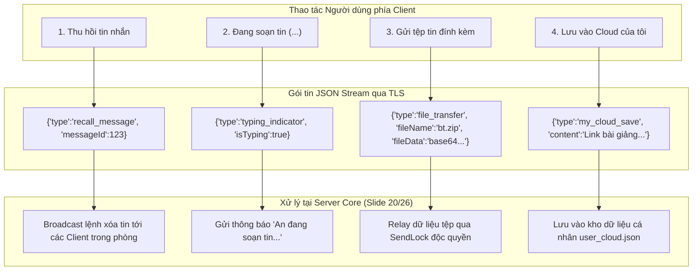

# Thiết Kế Chi Tiết Giao Diện & Kiến Trúc Zalo PC Desktop (100% Authentic Vietnam)
## Đồ án: Zalo Secure TCP Chat (Java Swing FlatLaf & TLS 1.3 Server)

**Tài liệu**: Đặc tả Thiết kế Giao diện (UI/UX Design Spec) & Mở rộng Backend  
**Kiến trúc**: Archetype B (Master–Detail / 3-Pane + Collapsible Inspector Drawer)  
**Tác giả**: Omni-IT Architect & Desktop Specialist  
**Ngày lập**: 07/11/2026

---

## 1. Lựa chọn Archetype & Cơ sở Thiết kế (Archetype Choice & Rationale)

### 1.1 Archetype: B. Master–Detail / 3-Pane Messaging Workbench
Ứng dụng nhắn tin trên máy tính của người Việt Nam (Zalo PC) phục vụ người dùng văn phòng và sinh viên làm việc từ 4 đến 8 tiếng mỗi ngày với chuột và bàn phím.
- **Tại sao chọn Archetype B**:
  - Tối ưu hóa cho màn hình rộng (1366x768, 1920x1080, 2K): Cho phép người dùng chuyển đổi nhanh giữa hàng chục cuộc trò chuyện khác nhau mà không bị mất dấu ngữ cảnh.
  - Phân tách không gian trực quan: Thanh điều hướng cực mỏng (64px) -> Danh bạ & hội thoại (320px) -> Khung chat trung tâm (Flex) -> Ngăn kéo thông tin mở rộng (Collapsible Drawer 280px).
  - Khác biệt với Web: Không có banner quảng cáo, không có cuộn trang kiểu landing page, độ phân giải chữ chuẩn desktop (13px), mật độ hiển thị thông tin cao (compact density).

---

## 2. Giải phẫu Cửa sổ Chính (Window Anatomy Wireframe)

```text
┌────────────────────────────────────────────────────────────────────────────────────────────────────────┐
│ [Zalo]  Tìm kiếm bạn bè, tin nhắn (Ctrl+F)                                                    ─  □  ✕  │ ← Title Bar (32px)
├────┬────────────────────────────┬───────────────────────────────────────────────┬──────────────────────┤
│NAV │ CONVERSATIONS  320px       │ CHAT VIEW (Flex)                              │ INFO DRAWER 280px    │
│64px│ ┌────────────────────────┐ │ ┌───────────────────────────────────────────┐ │ (Bật/tắt bằng Ctrl+I) │
│    │ │ 🔍 Tìm kiếm    [👥+][👤+]│ │ │ 👤 Nguyễn Văn An       🔒 TLS 1.3  [📞][🎥][ℹ]│ │ ┌──────────────────┐ │
│ 👤 │ ├────────────────────────┤ │ ├───────────────────────────────────────────┤ │ │    [ AVATAR ]    │ │
│User│ │ [Ưu tiên (3)]  [Khác]  │ │ │                                           │ │ │  Nguyễn Văn An   │ │
│    │ ├────────────────────────┤ │ │        ── Hôm nay, 07/11/2026 ──          │ │ │  ● Đang online   │ │
│ 💬 │ │ ● An (Nhóm SGU)  10:30 │ │ │                                           │ │ ├──────────────────┤ │
│Chat│ │   Chi: Đã nộp bài nhé! │ │ │ ┌──────┐ ┌──────────────────────────────┐ │ │ 📁 Ảnh/Video (12)  │ │
│ 👥 │ │   [badge: 2]       [📌]│ │ │ │Avatar│ │ Chào bạn! Bài tập LTM làm    │ │ │ 📄 Tệp tin (3)     │ │
│ danh│ │ ○ Trần Thị Bình  Hôm qua│ │ │ 32px │ │ đến đâu rồi?       10:28     │ │ │ 👥 Thành viên (4)  │ │
│ bạ │ │   Bạn: Ok nhé          │ │ └──────┘ └──────────────────────────────┘ │ │ ⚙ Cài đặt bảo mật  │ │
│ ☁️ │ │ ● Cloud của tôi   T5   │ │                 ┌─────────────────────────┐ │ │                      │ │
│Cloud│ │   [File] baitap.zip    │ │                 │ Mình vừa nạp TLS 1.3    │ │ │ 🚪 Rời cuộc trò    │ │
│    │ │                        │ │                 │ xong, chạy mượt lắm!    │ │ │    chuyện          │ │
│ ── │ │                        │ │                 │                   10:29 │ │ └──────────────────┘ │
│ ⚙️ │ │                        │ │                 │                     ✓✓  │ │                      │ │
│Set │ │                        │ │                 └─────────────────────────┘ │                      │ │
│    │ │                        │ │                                             │                      │ │
│ 🚪 │ │                        │ ├─────────────────────────────────────────────┤ │                      │ │
│Thoát│ │                        │ │ [😀][📎][📷][📝][⏰]                         │ │                      │ │
│    │ │                        │ ├─────────────────────────────────────────────┤ │                      │ │
│    │ │                        │ │ Nhập @, tin nhắn tới Nguyễn Văn An...       │ │                      │ │
│    │ │                        │ │                                    [ GỬI ]  │ │                      │ │
├────┴─┴────────────────────────┴─┴─────────────────────────────────────────────┴─┴──────────────────────┤
│ ● Đã kết nối TLS 1.3 (Port 5000)  │ Ping: 8ms  │ Mã hóa AES-256-GCM  │ SGU Lập trình mạng v1.0.0       │ ← Status bar (24px)
└────────────────────────────────────────────────────────────────────────────────────────────────────────┘
```

---

## 3. Danh mục Màn hình & Bề mặt Tương tác (Screen Inventory)

Hệ thống bao gồm **14 bề mặt tương tác (Surfaces)**:

1. **Cửa sổ Chính (Main Window)**:
   - View 1: Màn hình Trò chuyện (Chat View - 1-1 và Nhóm).
   - View 2: Màn hình Danh bạ (Contacts View - Danh sách bạn bè, lời mời kết bạn, danh sách nhóm).
   - View 3: Cloud của tôi (My Cloud - Kho lưu trữ ghi chú và file cá nhân).
2. **Ngăn phụ & Khung mở rộng (Drawers & Panels)**:
   - Panel 1: Ngăn kéo thông tin hội thoại bên phải (Conversation Info Drawer - 280px).
   - Panel 2: Khung chọn biểu tượng cảm xúc & Sticker Zalo (Emoji/Sticker Picker Popover).
3. **Cửa sổ Đăng nhập & Đăng ký (Auth Windows)**:
   - Cửa sổ Đăng nhập Zalo (Login Frame với nút chọn nhanh tài khoản mẫu).
   - Cửa sổ Đăng ký Tài khoản mới (Register Tab).
4. **Hộp thoại chức năng (Modal Dialogs)**:
   - Dialog 1: Tạo nhóm trò chuyện mới (chọn thành viên từ danh bạ checkbox).
   - Dialog 2: Thêm thành viên vào nhóm hiện tại.
   - Dialog 3: Xem và chỉnh sửa thông tin cá nhân (Profile Modal).
   - Dialog 4: Cài đặt ứng dụng (Settings: Phím tắt, Âm thanh, Máy chủ mạng).
5. **Menu ngữ cảnh (Context Menus - Chuột phải)**:
   - Context Menu 1: Trên danh sách hội thoại (Ghim lên đầu, Tắt thông báo, Xóa hội thoại).
   - Context Menu 2: Trên bong bóng tin nhắn (Sao chép, Thu hồi tin nhắn, Chuyển tiếp).
   - Context Menu 3: Trên khay hệ thống (System Tray Icon - Mở Zalo, Đăng xuất, Thoát).

---

## 4. Bảng Mã Màu & Quy chuẩn Giao diện Zalo (Design Tokens)

```css
:root {
  /* ── 1. MÀU SẮC THƯƠNG HIỆU ZALO (Zalo Brand Colors) ── */
  --zalo-primary:        #0068FF;  /* Màu xanh Zalo chủ đạo */
  --zalo-primary-hover:  #005AE0;  /* Trạng thái rê chuột */
  --zalo-primary-active: #0045B5;  /* Trạng thái nhấn giữ */
  --zalo-sidebar-bg:     #005AE0;  /* Nền thanh điều hướng trái */
  --zalo-sidebar-active: #0045B5;  /* Icon tab đang kích hoạt */

  /* ── 2. NỀN & BỀ MẶT (Surfaces) ── */
  --bg-window:           #FFFFFF;
  --bg-conversation-list:#FFFFFF;
  --bg-chat-stream:      #EBF0F5;  /* Nền xám xanh dịu mắt của Zalo PC */
  --bg-input-bar:        #FFFFFF;
  --bg-hover-item:       #F3F5F8;  /* Highlight khi hover chuột vào bạn bè */
  --bg-selected-item:    #E5EFFF;  /* Highlight khi chọn cuộc trò chuyện */
  
  /* ── 3. BONG BÓNG TIN NHẮN (Chat Bubbles) ── */
  --bubble-outgoing:     #D2E9FF;  /* Bong bóng tin nhắn CỦA MÌNH (Xanh nhạt) */
  --bubble-incoming:     #FFFFFF;  /* Bong bóng tin nhắn BẠN BÈ (Trắng tinh) */
  --bubble-border:       #E2E8F0;  /* Viền siêu mảnh chống lóa */

  /* ── 4. TRẠNG THÁI (Status Indicators) ── */
  --status-online:       #10B981;  /* Chấm xanh lá trực tuyến */
  --status-offline:      #9CA3AF;  /* Chấm xám ngoại tuyến */
  --badge-unread:        #EF4444;  /* Chấm đỏ đếm tin chưa đọc */
  --tick-delivered:      #6B7280;  /* Dấu tick đã nhận */
  --tick-seen:           #0068FF;  /* Dấu tick đôi màu xanh đã xem */

  /* ── 5. HỆ THỐNG TYPOGRAPHY (Desktop Font Scale) ── */
  --font-family:         "Segoe UI", -apple-system, "Arial", sans-serif;
  --font-size-xs:        11px;     /* Nhãn thời gian, badge */
  --font-size-sm:        12px;     /* Trạng thái, text phụ, preview */
  --font-size-base:      13px;     /* NỘI DUNG CHAT CHÍNH, ô input */
  --font-size-md:        14px;     /* Tên người dùng, tiêu đề hội thoại */
  --font-size-lg:        16px;     /* Tiêu đề cửa sổ, Header chat */
  --font-size-xl:        20px;     /* Logo Zalo */

  /* ── 6. BO GÓC & ĐỔ BÓNG (Shapes & Radii) ── */
  --radius-avatar:       50%;      /* Avatar tròn 100% */
  --radius-bubble:       14px;     /* Bo góc bong bóng chat */
  --radius-input:        18px;     /* Thanh tìm kiếm & input bo tròn */
  --radius-button:       8px;
}
```

---

## 5. Bản đồ Phím tắt Máy tính (Desktop Keyboard-First Map)

| Tổ hợp phím | Phạm vi tác động | Hành động thực hiện |
|:---|:---|:---|
| **Enter** | Khung soạn thảo | Gửi tin nhắn ngay lập tức |
| **Shift + Enter** | Khung soạn thảo | Xuống dòng trong tin nhắn |
| **Ctrl + F** | Toàn màn hình | Đưa con trỏ chuột vào ô Tìm kiếm danh bạ |
| **Ctrl + N** | Toàn màn hình | Mở hộp thoại Tạo nhóm trò chuyện mới |
| **Ctrl + I** | Khung chat | Bật/tắt ngăn kéo thông tin hội thoại bên phải |
| **Ctrl + K** | Khung chat | Thu hồi tin nhắn vừa gửi gần nhất |
| **Esc** | Mọi nơi | Đóng cửa sổ popover, hủy tìm kiếm hoặc đóng dialog |
| **Alt + F4** | Toàn ứng dụng | Thu nhỏ về khay hệ thống hoặc đăng xuất an toàn |

---

## 6. Mở rộng Tầng Backend & Hợp đồng Gói tin Zalo Đầy đủ

Để hiện thực hóa 100% trải nghiệm Zalo, tầng Backend Socket được mở rộng thêm các loại gói tin:



---

## 7. Các Tính năng Đặc trưng Zalo Việt Nam Cần Triển Khai Tiếp Theo

1. **Tính năng Thu hồi tin nhắn (Recall Message)**:
   - Cho phép người gửi thu hồi tin nhắn trong vòng 24 giờ.
   - Khi bấm "Thu hồi", bóng chat ở cả 2 máy chuyển thành: *"Tin nhắn đã được thu hồi"*.
2. **Chấm ba chấm "Đang nhập tin nhắn..." (Typing Indicator)**:
   - Khi đối phương đang gõ phím, hiển thị hoạt ảnh 3 chấm nhấp nháy dưới thanh header.
3. **Mục "Cloud của tôi" (My Cloud)**:
   - Một phòng chat đặc biệt với chính mình, giúp người dùng gửi file, link, note từ máy này để lưu trữ.
4. **Hệ thống Nhãn & Phân loại "Ưu tiên / Khác"**:
   - Tab "Ưu tiên" hiển thị tin nhắn bạn bè thân thiết.
   - Tab "Khác" gom các thông báo từ hệ thống và phòng chat chung.
5. **Thanh Toolbar Biểu tượng Cảm xúc & Gửi File**:
   - Đầy đủ nút Sticker mặt cười, nút gửi file tài liệu, và nút chụp màn hình nhanh.

